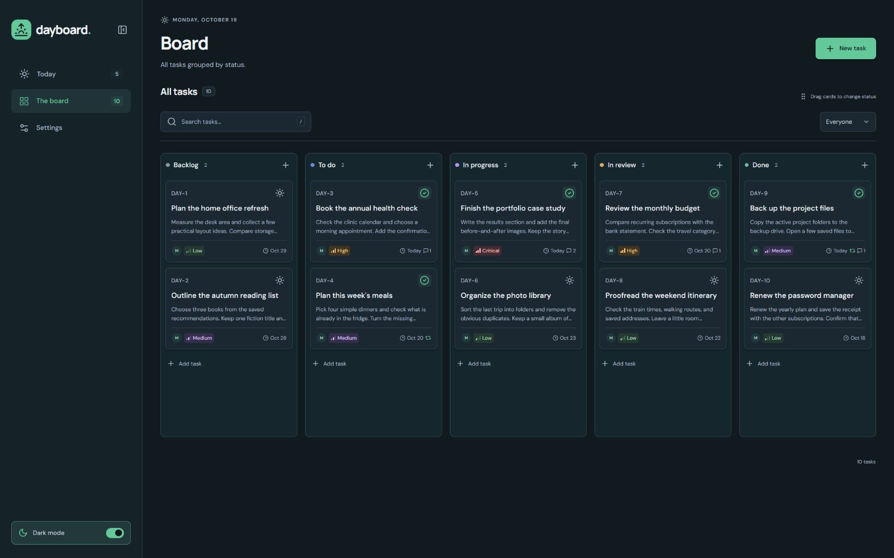
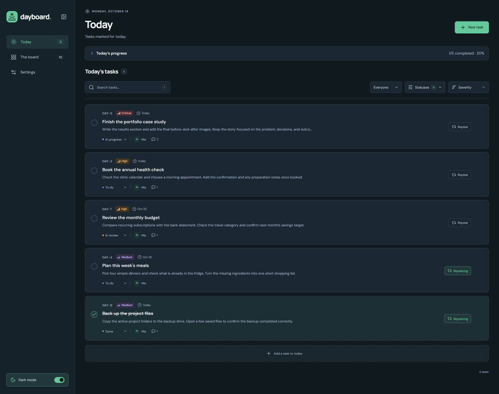
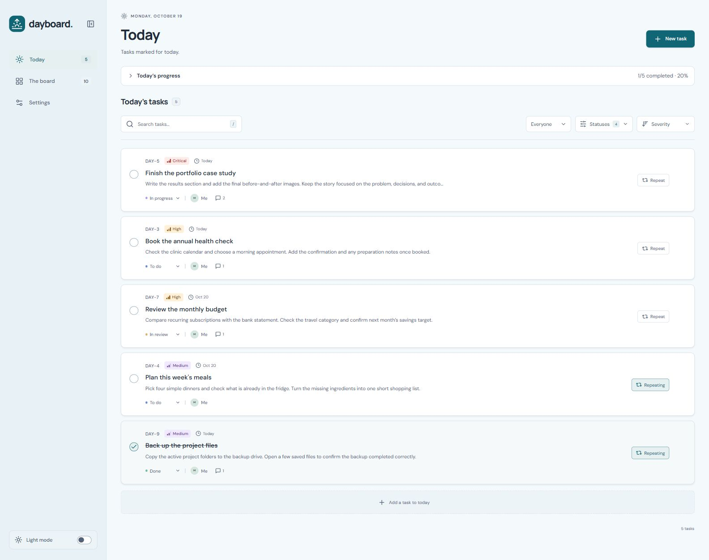
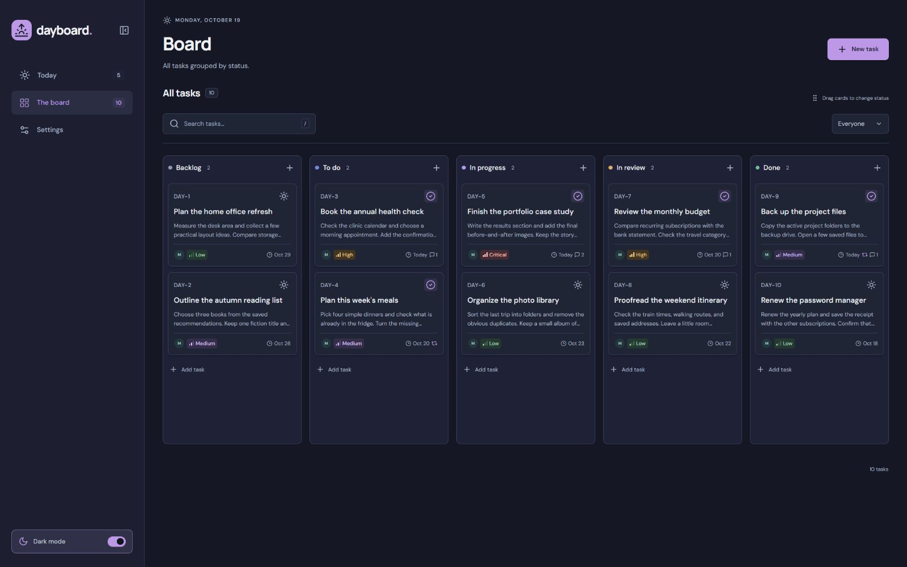
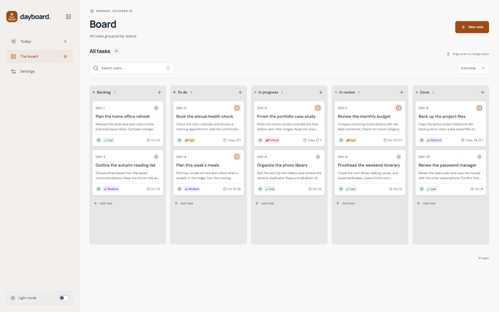
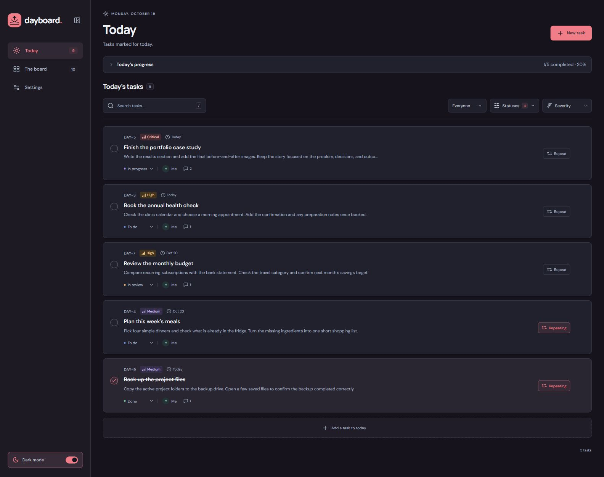

# Dayboard

A personal, self-hosted task board built around a simple workflow: keep everything on a Kanban board, then choose what to work on today.

Dayboard has no accounts or sign-in. Your board starts empty, and tasks, comments, and settings live in a readable JSON file.

## Screenshots

These desktop screenshots use example tasks in a separate demo board. New boards start empty.

### The board

All five default status columns are visible, with compact cards showing severity, assignee, due dates, and comment counts. Shown in dark Green.



### Today

A focused list of selected tasks, with status filters, severity or manual ordering, and repeat controls. Shown in dark Green.



<details>
<summary>Explore a few more themes</summary>

Every accent supports light and dark mode. Here are four of the 26 combinations:

| Light · Cyan | Dark · Purple |
| :--: | :--: |
|  |  |
| **Light · Orange** | **Dark · Blood red** |
|  |  |

</details>

## The workflow

1. **Capture work on the board.** Create tasks with an assignee, severity, dates, and description. Drag cards between statuses, or open a task to edit its details and add comments.
2. **Choose your day.** Mark tasks **For today** using the checkmark on their board cards. In **Today**, select which statuses appear and sort by severity or arrange tasks manually with dragging and arrow controls.
3. **Keep recurring work in view.** Use **Repeat** on a Today card to include it on future days. A repeat of **3 days** means tomorrow through three days from today; today's selection stays separate. **Forever** begins tomorrow with no end date. Removing a repeating task from Today skips only that day; **Stop repeating** ends the schedule.

Search and assignee filters help narrow either view. Today's dates and repeat schedules follow your browser's local calendar date.

## Quick start

Requires Git and Docker with Compose.

```sh
git clone https://github.com/iRewiewer/Dayboard.git
cd Dayboard
docker compose up --build -d
```

Open [localhost:9192](http://localhost:9192).

```sh
docker compose logs -f dayboard
docker compose down
```

Stopping or recreating the container preserves your board. `docker compose down --volumes` deletes its saved data.

To change the host port, copy `.env.example` to `.env` beside `compose.yaml` and set:

```dotenv
DAYBOARD_PORT=3100
```

Then run `docker compose up -d` and open [localhost:3100](http://localhost:3100). Compose binds to `127.0.0.1` by default. Dayboard has no authentication, so keep it private or provide access control before exposing it to other networks.

## Make it yours

**Settings** lets you choose the name shown on new comments, manage assignee names and colors, and add, rename, color, or reorder statuses. Assignees are labels you manage yourself. Removing an assignee makes its tasks unassigned. Move tasks out of a status before deleting it, and keep at least one status that is not marked completed.

**Appearance** offers 13 accent colors in light and dark mode: 26 combinations, with dark Green as the default. Appearance changes preview immediately; save to keep them, or reset or leave Settings to discard unsaved changes. The sidebar mode switch saves immediately while preserving your saved accent color.

The sidebar collapses to an icon rail on desktop or a compact header on mobile. Today's progress summary starts collapsed and expands when needed. Sidebar and progress layout choices are remembered per browser using local storage.

Task labels use `DAY-N` display numbers. New tasks get one more than the highest remaining number, starting at `DAY-1` on an empty board. Deleting the highest number allows reuse; existing tasks keep their numbers and stable internal UUIDs.

## Data and backups

Docker stores `/app/data/dayboard.json` in the named `dayboard-data` volume. The formatted JSON contains tasks, comments, assignees, statuses, appearance, Today filters, ordering, and repeat schedules. Browser layout choices stay local to each browser.

Run the following commands from the repository directory after the first startup. If you previously ran `docker compose down`, run `docker compose create dayboard` first to recreate the container without starting it.

Back up the board to a file outside the repository:

```sh
docker compose stop dayboard
docker compose cp dayboard:/app/data/dayboard.json ../dayboard-backup.json
docker compose start dayboard
```

Restore a backup, replacing the current board and its settings:

```sh
docker compose stop dayboard
docker compose cp ../dayboard-backup.json dayboard:/app/data/dayboard.json
docker compose run --rm --no-deps --user root --entrypoint sh dayboard -c "chown node:node /app/data/dayboard.json && chmod 600 /app/data/dayboard.json"
docker compose start dayboard
```

The ownership and permissions step makes the restored file readable by the container's `node` user across host platforms. Keep the service stopped while restoring or manually editing its JSON file.

## Development

Requires Node.js **22.12 or newer**. The production image uses Node.js 24. The frontend is React, TypeScript, and Vite; the backend uses Node's HTTP server and JSON file persistence.

The development API and Docker both use port 9192. If Docker is running Dayboard, stop it first with `docker compose stop dayboard`.

```sh
npm ci
npm run dev
```

Open [localhost:5173](http://localhost:5173). Vite proxies API requests to port 9192. Development data lives in `data/dayboard.json` inside the repository and is excluded from Git.

```sh
npm test
npm run build
```

After stopping the development server, `npm start` serves the built frontend and API together at [localhost:9192](http://localhost:9192). `DATA_DIR` changes the backend data directory, and `PORT` changes its listening port; Vite's development proxy follows the same `PORT` value (default `9192`).

Source lives in `src/`, the HTTP API and persistence in `server/`, and behavior tests in `server/` and `tests/`. The Docker image runs as an unprivileged user and checks `/api/health`.

## Project direction

Dayboard is a personal tool shared for anyone who finds it useful. Suggestions and improvements are welcome; design and feature decisions follow the maintainer's own daily workflow first.

## License

[AGPL-3.0](LICENSE).
